# hshield — Linux Kernel Containment & Supply-Chain Security Engine

[](https://github.com/Hephaestus-Zero/hshield/actions/workflows/ci.yml)
[](https://github.com/Hephaestus-Zero/hshield/releases/latest)
[](LICENSE)

`hshield` is a zero-runtime-overhead C11 defensive security toolkit for Linux workstations, CI runners, and AI coding agents operating on untrusted repositories, build hooks, and serialized ML artifacts. It unifies unprivileged Linux **Landlock LSM** (`ABI v1–v6`) filesystem, TCP port, and IPC isolation, coding-agent `.mcp.json` and Trojan-Source repository auditing, zero-import **Pickle VM (Protocols 0–5) / PyTorch ZIP** static RCE scanning, and optional `fanotify`/`CN_PROC` runtime execution containment.



## Quick Install

- **Homebrew (Linuxbrew):**
  ```bash
  brew install Hephaestus-Zero/tap/hshield
  ```
- **Agent Skill / Claude Code Plugin:**
  ```bash
  npx skills add Hephaestus-Zero/hshield
  # or in Claude Code:
  # /plugin marketplace add Hephaestus-Zero/hshield
  ```
- **Prebuilt Binary (`x86_64` Linux):**
  ```bash
  curl -fsSL https://raw.githubusercontent.com/Hephaestus-Zero/hshield/main/install.sh | sh
  ```

Or build locally with `gcc`, `libcrypto`, and `zlib`:

```bash
make
make test
sudo make install   # or: make install PREFIX="$HOME/.local"
```

## Coding-Agent & Sandbox Usage (`v0.2.1`)

```bash
# 1. Agent preset: hide ~/.ssh, ~/.aws, browser cookies & dotfiles; RW only on cwd; allow only outbound TCP 443
hshield agent -- claude
hshield sandbox --agent --allow-write ./workspace -- pytest -q

# 2. Completely offline test execution (--deny-net enforces Landlock ABI v4+ TCP bind/connect deny)
hshield sandbox --deny-net --allow-write /tmp/build-out -- python3 untrusted_setup.py

# 3. Granular egress/ingress port allowlists
hshield sandbox --deny-net --allow-tcp-connect 443,8443 -- npm test
hshield sandbox --deny-net --allow-tcp-bind 8080 -- python3 -m http.server 8080

# 4. Audit a freshly cloned repo before opening it in an IDE or AI coding agent
hshield audit /path/to/cloned-repo --json

# 5. Statically inspect PyTorch checkpoints, Pickle files, or disguised archives without importing Python
hshield-supply-scan --json model_weights.pt dataset.pkl archive.zip
```

## GitHub Actions Usage

Drop `hshield` directly into any repository CI workflow to catch `.mcp.json` / `.claude` hook traps, invisible Unicode Trojan-Source overrides, disguised ELFs, and Pickle RCE payloads on pull requests:

```yaml
- uses: Hephaestus-Zero/hshield@v0.2.1
  with:
    path: .
    scan-artifacts: 'true'
```

## How `hshield` Compares

| Capability | `hshield` (C11) | `landrun` (Go) | `bubblewrap` / `srt` | `picklescan` (Python) |
|---|---|---|---|---|
| **Landlock FS (`ABI v1–v5`)** | Yes | Yes | Mount namespaces | No |
| **Landlock TCP Port Rules (`ABI v4+`)** | Yes (`--deny-net`, `--allow-tcp-*`) | Yes | Network ns / proxy | No |
| **Landlock Signal & Abstract Socket Scope (`ABI v6`)** | Yes | Kernel-dependent | PID/net namespaces | No |
| **Unprivileged (No `CAP_SYS_ADMIN` / SUID / `CLONE_NEWUSER`)** | Yes | Yes | Often needs userns | N/A |
| **AI Agent Trap Audit (`.mcp.json`, hooks, Trojan Unicode)** | Yes (`hshield audit`) | No | No | No |
| **Zero-Import Pickle VM (P0–P5) & ZIP Header Scan** | Yes (`hshield-supply-scan`) | No | No | Python-based |
| **Optional Root `fanotify` + `CN_PROC` Quarantine** | Yes (`hshield --daemon`) | No | No | No |

## Threat Model & Components

| Component | Privilege | Primitives | Purpose |
|---|---|---|---|
| `hshield sandbox` / `hshield agent` | Unprivileged (`PR_SET_NO_NEW_PRIVS`) | Landlock LSM `ABI v1–v6` (FS + TCP connect/bind + signal/abstract UNIX socket scoping) | Isolates untrusted scripts and coding agents with read-only OS mounts, omitted `$HOME` secrets, scoped writes, and port-level TCP egress/ingress filtering. |
| `hshield audit` | Unprivileged | Deterministic file & UTF-8 codepoint scanner | Flags rogue `.mcp.json`, `.claude` / `.codex` / `.gemini` workspace hooks, invisible `U+202A..U+202E` / `U+200B..U+200D` bidirectional overrides, and `/etc/ld.so.preload` hooks. |
| `hshield-supply-scan` | Unprivileged | Zero-extract `zlib` Central Directory parser + Pickle Proto 0–5 opcode VM scanner | Detects `GLOBAL` / `STACK_GLOBAL` + `REDUCE` code execution chains (`posix.system`, `subprocess`, `eval`, `exec`) inside `.pkl`, `.pt`, `.pth`, `.ckpt`, and disguised ELF binaries. |
| `hshield --daemon` | `CAP_SYS_ADMIN` (optional) | `fanotify` (`FAN_OPEN_PERM`), `NETLINK_CONNECTOR` (`CN_PROC`), `timerfd`, OpenSSL AES-256-GCM | Optional background daemon for canary traps, `memfd_create` / anonymous `RWX` detection, and encrypted forensic quarantine. |

## License

MIT License — Copyright (c) 2026 Hephaestus-Zero.
